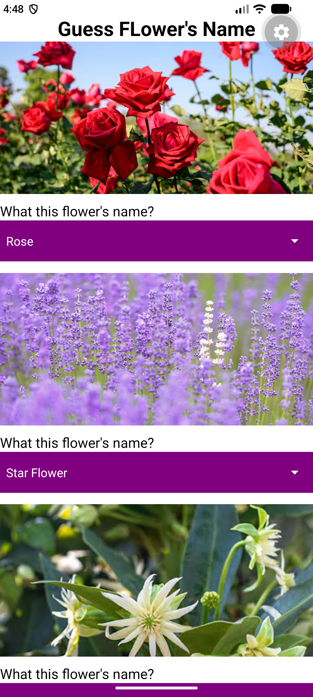
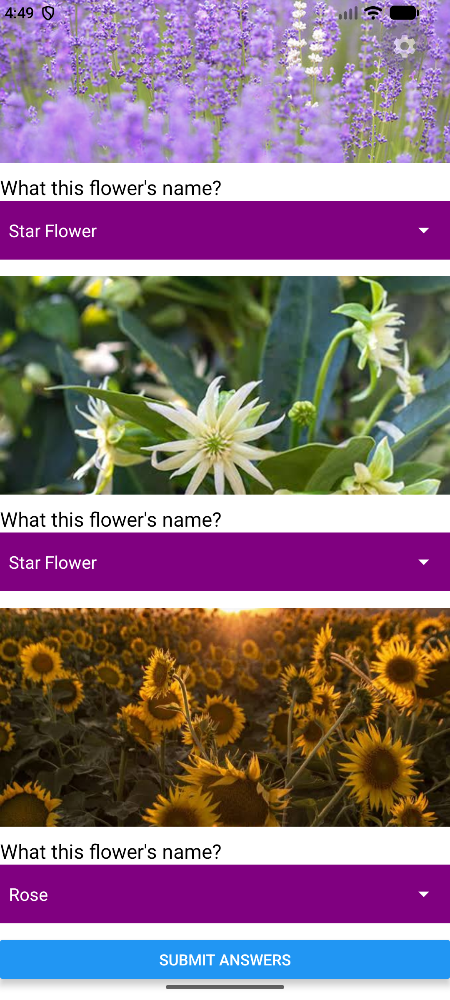

# App Name

A simple quiz app built with React Native (Expo). The app shows a picture of a flower and asks the user to identify it. The user chooses an answer from a Picker for each question, then presses **SUBMIT ANSWERS** to see how many answers are correct.

# Features Highlight

**Features**
- 3 quiz questions, each showing an online image of a flower
- A Picker (dropdown) for each question with 4 flower options (e.g. Rose, Sunflower, Tulip, Lily)
- A **SUBMIT ANSWERS** button that shows an Alert with the number of correct answers
- The feedback message changes depending on the score:
    - 3 correct: "Well done! Perfect score!"
    - 2 correct: "Good job!"
    - 0–1 correct: "You can do better next time."
- An app title with an icon (🌸)
- A green option box for each Picker
- A ScrollView so the user can scroll through all the questions

# ScreenShots of App

Screenshots:  

